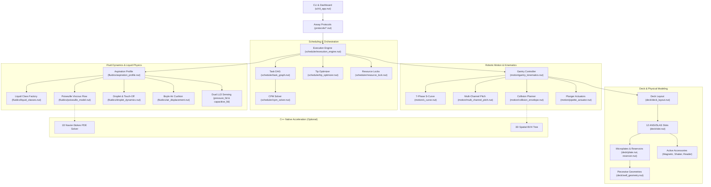
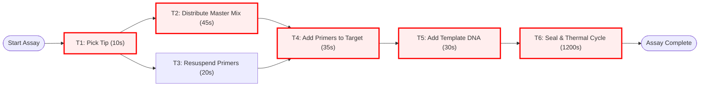
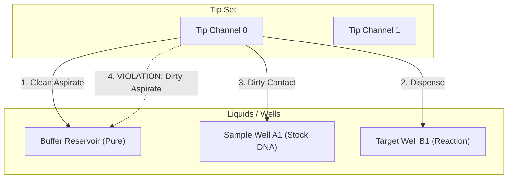

# Spigot Architecture & System Diagrams

This document collects architectural, fluidic, kinematic, and scheduling diagrams illustrating the internal mechanisms of Spigot.

---

## 1. System Architecture Overview



---

## 2. Micro-Fluidic Meniscus & Pendant Droplet Anatomy

```
         +-----------------------------+
         |     Pipette Tip Barrel      |
         |         (Radius r1)         |
         \                             /
          \                           /
           \                         /
            \                       /
             \                     /
              \     Conical       /
               \     Taper       /
                \               /
                 |             |
                 | Nozzle (r2) |
                 +-----+ +-----+
                       | |
                  ..---' '---..
                .'             '.   Pendant Droplet (V_drop)
               /                 \  Held by Surface Tension: F_gamma = 2 * pi * r2 * gamma
              |                   | Opposed by Gravity: F_g = rho * V_drop * g
               \                 /
                '.             .'
                  ''---------''
                       |
                       v [If V_drop < V_crit => Touch-Off Required]
      ------------------------------------ Well Wall
```

---

## 3. 7-Phase Jerk-Limited S-Curve Kinematics Profile

```
Acceleration a(t):
               +----------------+  (Phase 2: a = +A_max)
              /                  \
   Phase 1   /                    \ Phase 3
  (j = +J)  /                      \ (j = -J)
  ---------+                        +-----------------------+ (Phase 4: a = 0)
                                     \                     /
                                      \                   /
                                       \                 /
                                        +---------------+  (Phase 6: a = -A_max)
                                      Phase 5           Phase 7
                                     (j = -J)          (j = +J)

Velocity v(t):
                                    +-----------------------+ (Phase 4: v = V_max)
                                  .'                         '.
                                .'                             '.
                              .'                                 '.
  ---------------------------+                                     +------------- (v = 0)
     Acceleration Segment                                      Deceleration Segment
```

---

## 4. Assay Scheduling DAG & Critical Path Method (CPM)



---

## 5. 12-Slot Workstation Deck Coordinate System

```
  Y (500 mm)
    ^
    |  +--------------------+  +--------------------+  +--------------------+  +--------------------+
    |  | Slot 9 (Row 3)     |  | Slot 10 (Row 3)    |  | Slot 11 (Row 3)    |  | Slot 12 (Row 3)    |
    |  | [127.76 x 85.48 mm]|  | [127.76 x 85.48 mm]|  | [127.76 x 85.48 mm]|  | [127.76 x 85.48 mm]|
    |  +--------------------+  +--------------------+  +--------------------+  +--------------------+
    |
    |  +--------------------+  +--------------------+  +--------------------+  +--------------------+
    |  | Slot 5 (Row 2)     |  | Slot 6 (Row 2)     |  | Slot 7 (Row 2)     |  | Slot 8 (Row 2)     |
    |  | [127.76 x 85.48 mm]|  | [127.76 x 85.48 mm]|  | [127.76 x 85.48 mm]|  | [127.76 x 85.48 mm]|
    |  +--------------------+  +--------------------+  +--------------------+  +--------------------+
    |
    |  +--------------------+  +--------------------+  +--------------------+  +--------------------+
    |  | Slot 1 (Row 1)     |  | Slot 2 (Row 1)     |  | Slot 3 (Row 1)     |  | Slot 4 (Row 1)     |
    |  | [127.76 x 85.48 mm]|  | [127.76 x 85.48 mm]|  | [127.76 x 85.48 mm]|  | [127.76 x 85.48 mm]|
    |  +--------------------+  +--------------------+  +--------------------+  +--------------------+
    |
  (0,0)-----------------------------------------------------------------------------------------> X (750 mm)
```

---

## 6. Contamination Bipartite Audit Graph


